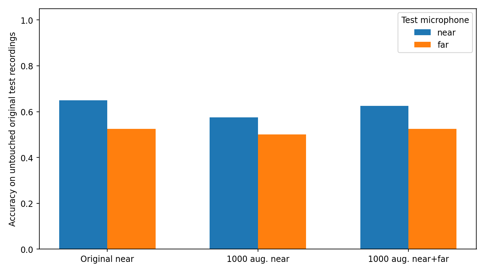

# Fan Condition Classification: Microphone Distance and Audio Augmentation

**EF2039 PA04 - Classroom Research Project**

This project studies **normal vs anomalous fan sound classification** using real two-channel DCASE 2026 recordings. It is **not** a low/medium/high fan-speed classifier. A supervised Random Forest baseline is used. **These are new classroom train/validation/test splits, not official DCASE benchmark scores.**

## Research questions

1. Does testing the same model on the far microphone reduce accuracy relative to the near microphone?
2. Does training-only augmentation of 1,000 derived WAV clips, with or without far-microphone data, improve accuracy on held-out original recordings?

## Source data and license

- Source: [DCASE 2026 Challenge Task 2 Development Dataset — fan](https://zenodo.org/records/19336329), original file `dev_fan.zip` (approximately 704 MB).
- The original source provides two paired microphone channels for every recording. Channel 0 is treated as **near**, and channel 1 as **far**. Exact microphone distances in meters are not claimed.
- The data were collected for *unsupervised anomalous sound detection*. For this **separate educational supervised experiment**, we use labeled recordings from the official test portion, then create new splits; therefore results cannot be compared directly with official DCASE challenge scores.
- See `DATA_LICENSE_AND_CITATION.md` for citation, provenance, and original audio license (**CC BY-NC-SA 4.0**). Audio files are **not redistributed** in this repository.

## Reproduce from scratch

With a clean Python environment, run:

```bash
python -m pip install -r requirements.txt
python download_real_data.py --out data/real_binary --per-class 100
python check_data.py --data data/real_binary
python augment_1000.py --source data/real_binary --out data/augmented_binary_1000 --count 1000
python run_augmented_experiments.py --source data/real_binary --augmented data/augmented_binary_1000 --out results/augmented_binary
```

The download step fetches the official `dev_fan.zip` and verifies its checksum. If you have already placed the original ZIP in `data/dev_fan.zip`, replace that line with:

```bash
python download_real_data.py --no-download --out data/real_binary --per-class 100
```

The downloader may need internet access, disk space, and time. On repeated runs, remove or choose new output directories for data that already contains a `manifest.csv`; the scripts refuse to silently overwrite existing manifests.

Environment: see `requirements.txt` and the example `environment.yml` (Conda). The original experiment ran in Backend.AI using Python 3.12; `environment.yml` specifies a compatible Python 3.10 alternative. For an exact recreation, use package versions captured from the original run (to be added as `installed_versions.txt`). CPU execution is supported; a GPU is not required.

## Experimental setup

- 200 original stereo recordings: 100 normal, 100 anomaly.
- Original recordings split *before augmentation*: 120 training, 40 validation, 40 test (stratified, fixed random seed **2026**).
- 1,000 augmented stereo training files. All derivatives come only from original **training** recordings, never from held-out validation or test recordings.
- Feature extraction: fixed-duration audio energy and spectrum features, then Random Forest (`n_estimators=120`, `max_depth=16`, `min_samples_leaf=2`, `class_weight='balanced'`, `random_state=2026`).
- Three comparisons: **original_near_only**, **augmented_near_only**, **augmented_near_far**. The last setting supplies 2,000 *channel examples* from 1,000 derived stereo files, not 2,000 independent fan recordings.
- Each model is evaluated on the same 40 untouched original test recordings, once via the near channel and once via the far channel.
- The reserved validation split was not used to optimize a hyperparameter search in this experiment.

## Observed results

| Training condition | Near accuracy | Far accuracy | Near macro-F1 | Far macro-F1 |
|---|---:|---:|---:|---:|
| Original near only | 0.650 | 0.525 | 0.649 | 0.525 |
| 1,000 augmented near only | 0.575 | 0.500 | 0.552 | 0.333 |
| 1,000 augmented near + far | 0.625 | 0.525 | 0.619 | 0.522 |



See `results/augmented_binary/summary.csv` for exact stored results, `experiment_info.json` for split sizes and conditions, confusion matrices in CSV format, and three `.joblib` files for trained model weights.

**Interpretation:** In this specific held-out set, all three models scored lower on the far microphone. Augmentation did not improve near-microphone accuracy relative to the original-only baseline. Accuracy is low, the test set is small, and normal/anomaly examples may differ in domain and acquisition conditions. These results are not evidence of robust real-world fault detection.

## Predict on a new recording

For a compatible stereo WAV, e.g. a downloaded test clip:

```bash
python predict.py --audio data/real_binary/normal_000.wav --model results/augmented_binary/original_near_only_model.joblib --channel near
```

## Project files

- `download_real_data.py`: download and extract real labeled recordings, preserving two channels.
- `check_data.py`: inspect the original dataset and labels.
- `augment_1000.py`: split originals and generate 1,000 augmented *training-only* clips.
- `run_experiments.py`: acoustic feature extractor and Random Forest model definition.
- `run_augmented_experiments.py`: all three comparisons, evaluation, graph and model exports.
- `predict.py`: inference for a single WAV.
- `results/augmented_binary/`: saved metrics, confusion tables, graph, and three trained classifiers.

## Transparency and limitations

The full original dataset (704 MB) and the augmented WAVs are intentionally not checked into GitHub. They can be recreated using the recorded source and fixed seed. **For strongest reproducibility, also include the actual files `data/real_binary/manifest.csv`, `data/augmented_binary_1000/original_splits.csv`, `data/augmented_binary_1000/manifest.csv`, and `data/augmented_binary_1000/augmentation_info.json` from the completed Backend.AI session** in a folder named `metadata/` (do not upload WAV files). These are not bundled because the actual Backend.AI data folder was not provided along with the results ZIP.

All filenames and labels in the README describe the revised **normal/anomaly** task, not the abandoned fan-speed experiment. Do not upload the old synthetic demonstration dataset as if it were real audio.
