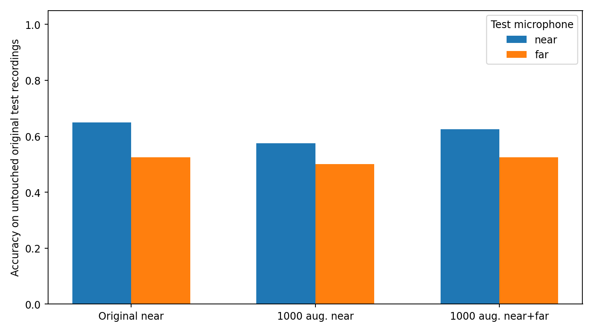

# Fan Condition Classification: Microphone Distance and Audio Augmentation

**EF2039 PA04 - Classroom Research Project**

This project studies **normal vs anomalous fan sound classification** using real two-channel DCASE 2026 recordings. It is **not** a low/medium/high fan-speed classifier. A supervised Random Forest baseline is used. **These are new classroom train/validation/test splits, not official DCASE benchmark scores.**

## Research questions

1. Does testing the same model on the far microphone reduce accuracy relative to the near microphone?
2. Does training-only augmentation of 1,000 derived WAV clips, with or without far-microphone data, improve accuracy on held-out original recordings?

## Source data and license

- Source: [DCASE 2026 Challenge Task 2 Development Dataset — fan](https://zenodo.org/records/19336329), original file `dev_fan.zip` (approximately 704 MB).
- The original source provides two paired microphone channels for every recording. Channel 0 is treated as **near**, and channel 1 as **far**. Exact microphone distances in meters are not claimed.
- The data were collected for *unsupervised anomalous sound detection*. For this **separate educational supervised experiment**, we use labeled recordings from the official test portion, then create new splits; therefore results cannot be compared directly with official DCASE challenge scores.
- See `DATA_LICENSE_AND_CITATION.md` for citation, provenance, and original audio license (**CC BY-NC-SA 4.0**). Audio files are **not redistributed** in this repository.

## Reproduce from scratch

Use Python 3.12 in a fresh clone. On Backend.AI or Linux:

```bash
git clone https://github.com/mjg5904/EF2039_PA04_Fan_Sound_Classification.git
cd EF2039_PA04_Fan_Sound_Classification
python -m venv .venv
source .venv/bin/activate
python -m pip install -r metadata/reproduction_requirements.txt
python download_real_data.py --out data/real_binary --per-class 100
python check_data.py --data data/real_binary
python augment_1000.py --source data/real_binary --out data/augmented_binary_1000 --count 1000
python run_augmented_experiments.py --source data/real_binary --augmented data/augmented_binary_1000 --out results/reproduced
diff -u results/augmented_binary/summary.csv results/reproduced/summary.csv
```

If the official ZIP is already available locally, replace the download line with `python download_real_data.py --zip /path/to/dev_fan.zip --no-download --out data/real_binary --per-class 100`, substituting its actual path. The script verifies the official checksum. Use fresh output directories for data preparation; existing manifests are not overwritten. CPU execution is sufficient (tested with two CPU cores and 10 GiB RAM); internet access and disk space are needed for the dataset. The broad dependency ranges in `requirements.txt` and example `environment.yml` are alternatives, not the exact verified environment. The pinned file records the successful reproduction environment; the original run's full pip freeze was not captured.

## Experimental setup

- 200 original stereo recordings: 100 normal, 100 anomaly.
- Original recordings split *before augmentation*: 120 training, 40 validation, 40 test (stratified, fixed random seed **2026**).
- 1,000 augmented stereo training files. All derivatives come only from original **training** recordings, never from held-out validation or test recordings.
- Feature extraction: fixed-duration audio energy and spectrum features, then Random Forest (`n_estimators=120`, `max_depth=16`, `min_samples_leaf=2`, `class_weight='balanced'`, `random_state=2026`).
- Three comparisons: **original_near_only**, **augmented_near_only**, **augmented_near_far**. The last setting supplies 2,000 *channel examples* from 1,000 derived stereo files, not 2,000 independent fan recordings.
- Each model is evaluated on the same 40 untouched original test recordings, once via the near channel and once via the far channel.
- The reserved validation split was not used to optimize a hyperparameter search in this experiment.

## Observed results

| Training condition | Near accuracy | Far accuracy | Near macro-F1 | Far macro-F1 |
|---|---:|---:|---:|---:|
| Original near only | 0.650 | 0.525 | 0.649 | 0.525 |
| 1,000 augmented near only | 0.575 | 0.500 | 0.552 | 0.333 |
| 1,000 augmented near + far | 0.625 | 0.525 | 0.619 | 0.522 |



See `results/augmented_binary/summary.csv` for exact stored results, `experiment_info.json` for split sizes and conditions, confusion matrices in CSV format, and three `.joblib` files for trained model weights.

**Interpretation:** In this specific held-out set, all three models scored lower on the far microphone. Augmentation did not improve near-microphone accuracy relative to the original-only baseline. Accuracy is low, the test set is small, and normal/anomaly examples may differ in domain and acquisition conditions. These results are not evidence of robust real-world fault detection.

## Predict on a new recording

For a compatible stereo WAV, e.g. a downloaded test clip:

```bash
python predict.py --audio data/real_binary/normal_000.wav --model results/augmented_binary/original_near_only_model.joblib --channel near
```

## Project files

- `download_real_data.py`: download and extract real labeled recordings, preserving two channels.
- `check_data.py`: inspect the original dataset and labels.
- `augment_1000.py`: split originals and generate 1,000 augmented *training-only* clips.
- `run_experiments.py`: acoustic feature extractor and Random Forest model definition.
- `run_augmented_experiments.py`: all three comparisons, evaluation, graph and model exports.
- `predict.py`: inference for a single WAV.
- `results/augmented_binary/`: saved metrics, confusion tables, graph, and three trained classifiers.

## Transparency and limitations

The original archive and derived WAVs are not redistributed. The fixed-seed scripts regenerate them from the official data source. `metadata/real_source_manifest.csv`, `metadata/original_splits.csv`, `metadata/augmentation_manifest.csv`, and `metadata/augmentation_info.json` record the actual data selection, splits, and augmentation used for the reported results. The test set was not augmented. These are classroom supervised results, not official DCASE benchmark scores. The sample size is small and model C includes twice as many channel examples as B. Accuracy alone hides class-specific errors; the far-channel model B missed all 20 anomalies.

## Reproducibility verification

On November 15, 2026, all three models were retrained and evaluated in a fresh GitHub clone on Backend.AI using the official dataset archive. All six accuracy and macro-F1 pairs matched the original results exactly, and `diff -u` reported no difference between the two summary CSV files. The reproduction environment is recorded in `metadata/reproduction_requirements.txt`. The single-file inference helper uses the same two-second center crop as the evaluation code; it does not change the reported training or evaluation results.
